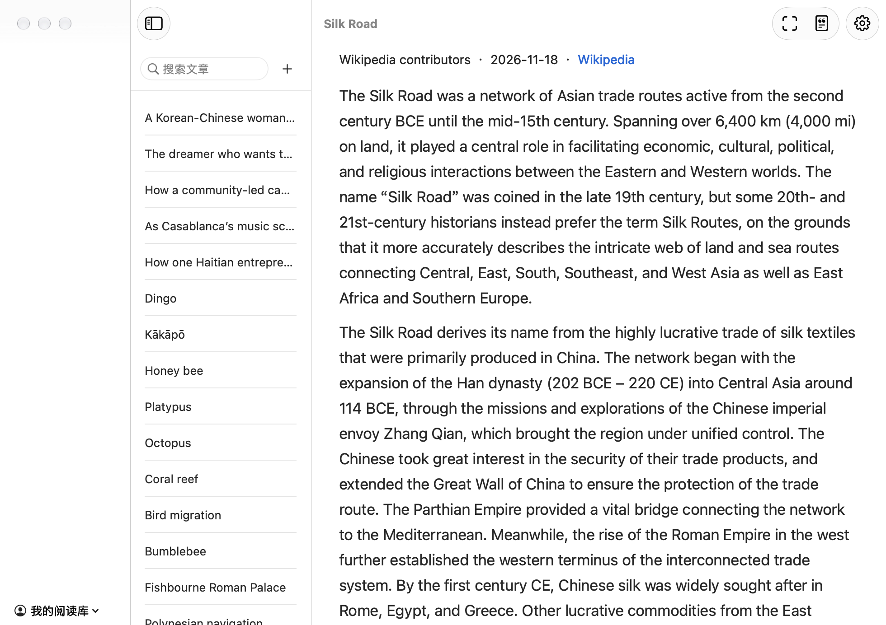
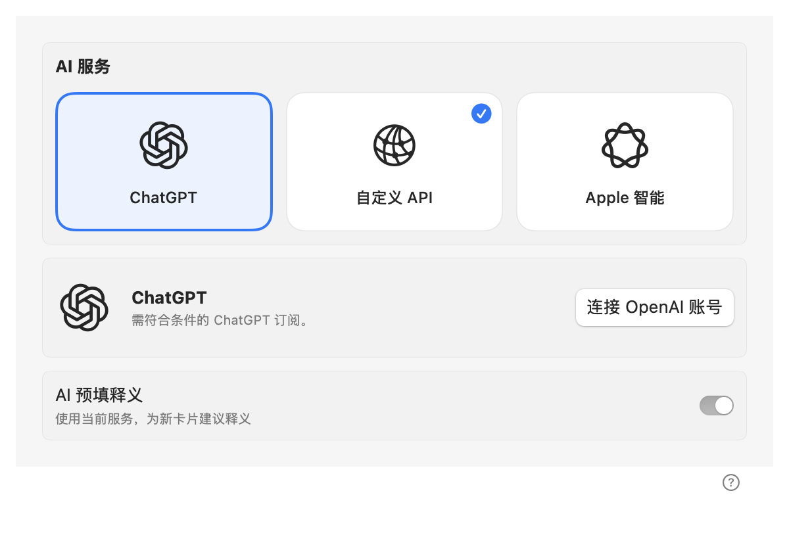
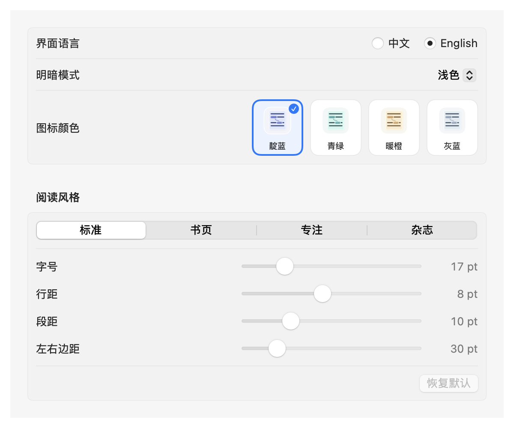

<div align="center">
  <h1>WordLinks (词文库)</h1>
  <p>
    <strong>Native macOS English Reading Library &amp; Contextual Vocabulary Builder</strong><br />
    Read continuously, save contextual word cards, and explore interactive AI-powered intensive reading.
  </p>
  <p>
    <a href="README.md">English</a> · <a href="README.zh-CN.md"><strong>简体中文</strong></a>
  </p>
  <p>
    <a href="https://github.com/taoz66/WordLinks/releases/latest">
      
    </a>
    
    
  </p>
</div>

---

## App Preview

<div align="center">
  
  <p><em>Three-column native reader with continuous typography, bundled open-licensed library, and one-click Focus / Intensive modes.</em></p>
</div>

---

## Key Features

### 1. Native Continuous Reader & Focus Mode
- Built natively with **SwiftUI + AppKit (`NSTextView`)**, supporting Light/Dark appearance and macOS 26+ Liquid Glass.
- **Four Reading Themes**: **Standard**, **Book**, **Focus**, and **Magazine**, each with independent font size, line spacing, paragraph gaps, and side margins.
- **Distraction-Free Focus Mode (`⇧⌘F`)**: Collapses library sidebars and auto-hides window chrome while reading.
- **Markdown & File Sync**: Full Markdown and YAML frontmatter support, in-page search (`⌘F` / `⌘G`), and live synchronization with external `.md` / `.txt` files.

### 2. Contextual Vocabulary & Study Library
- **Highlight & Save Cards**: Select any word or phrase in context to record its expression, definition, and exact source sentence snapshot.
- **Offline Morphology Prefill**: Automatically suggests base word forms from the bundled English lexicon (e.g., `books → book`, `arriving → arrive`) without overwriting manual edits.
- **Words & Articles Views**: Review cards grouped by normalized word entries or in original reading order, jump straight back to the source passage, edit inline with `⌘Z` Undo/Redo, and export a 6-column CSV (`⌘E`) or full JSON profile backup.

### 3. AI-Powered Intensive Reading & Smart Prefill
- **Intensive Mode (Sentence-by-Sentence + Bilingual Alignment)**: Displays natural translations below each sentence with interactive hover highlighting linking English words to their corresponding Chinese phrases.
- **33 Built-in Offline Intensive Editions**: Core bundled articles include pre-generated, strictly verified bilingual alignments (`intensive-reading.json`)—works **out of the box offline** with zero API cost.
- **Flexible Multi-Provider AI**:
  - **ChatGPT**: Official open-source OAuth sign-in flow (`ChatGPT` subscription).
  - **Custom OpenAI-Compatible API**: Connect any remote LLM endpoint or local runner (Ollama, LM Studio, vLLM, etc.).
  - **Apple Intelligence**: On-device system model support on macOS 26+.
- **AI Definition Prefill & Ask AI**: Select a word or passage to get contextual explanations, or enable smart definition suggestions in the card editor (strictly separated from your manual notes). All credentials are stored securely in macOS Keychain.

<div align="center">
  <table>
    <tr>
      <td align="center" width="50%">
        
        <br /><sub><b>Multi-Provider AI Settings &amp; Smart Prefill</b></sub>
      </td>
      <td align="center" width="50%">
        
        <br /><sub><b>Bilingual UI, App Icon Variants &amp; Reading Styles</b></sub>
      </td>
    </tr>
  </table>
</div>

---

## Download & Installation

### Option 1: Download DMG (Recommended)
1. Go to [**GitHub Releases**](https://github.com/taoz66/WordLinks/releases/latest) and download **`WordLinks-v1.0.0.dmg`**.
2. Open the `.dmg` file and drag **Wordlinks.app** into your **Applications** folder.
3. On first launch, if macOS Gatekeeper warns about an unsigned/locally-signed developer build, right-click **Wordlinks.app** → **Open** (or allow it in **System Settings → Privacy & Security**).

### Option 2: Build from Source

**Requirements**: macOS 14.0+, Xcode 16+ / Swift 5.9+ (Xcode 26+ recommended for macOS 26 SDK `FoundationModels` & native layered icon compilation).

```sh
git clone https://github.com/taoz66/WordLinks.git
cd WordLinks

# Build, sign, and package Wordlinks.app
zsh Scripts/build-app.sh
open build/Wordlinks.app
```

Run tests:
```sh
swift test
```

> Local user profiles and automatic backups are stored under `~/Library/Application Support/ReadingToolDaily/`. You can also load personal offline collections from `LocalCollections/*/catalog.json` inside that directory.

---

## Bundled Open-Licensed Library (50 Articles)

WordLinks ships with **50 curated, reading-friendly articles** cleaned of inline citations and media clutter, with full author, publication date, source links, and license attribution preserved:

| Collection | Articles | License | Topics |
| --- | :---: | --- | --- |
| **Global Voices** | 5 | [CC BY 3.0](https://globalvoices.org/about/global-voices-attribution-policy/) | Culture, language preservation, local stories |
| **Wikipedia** | 30 | [CC BY-SA 4.0](https://creativecommons.org/licenses/by-sa/4.0/) | Ecology, wildlife, archaeology, history of science |
| **PLOS** | 15 | [CC BY 4.0](https://journals.plos.org/plosbiology/s/licenses-and-copyright) | Open science, biodiversity, *Ten Simple Rules* |

---

## Documentation

- [Product Conventions (中文)](docs/产品约定.md)
- [Architecture & Maintenance (中文)](docs/架构与维护.md)
- [ChatGPT OAuth Integration](docs/chatgpt-integration.md)
- [Article Templates (EN / 中文)](docs/article-templates/article-template.en.md)

---

## License

The source code, build scripts, and documentation of WordLinks are licensed under the [MIT License](LICENSE). Bundled linguistic databases and open-licensed reading articles retain their respective licenses under `Sources/ReadingToolDaily/Resources/`.
