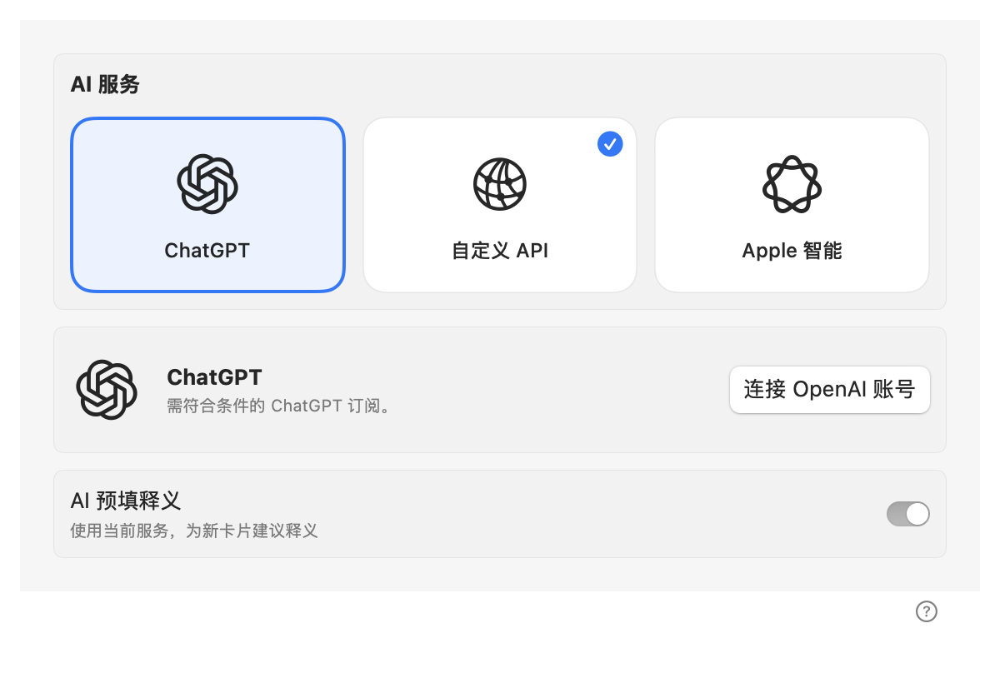
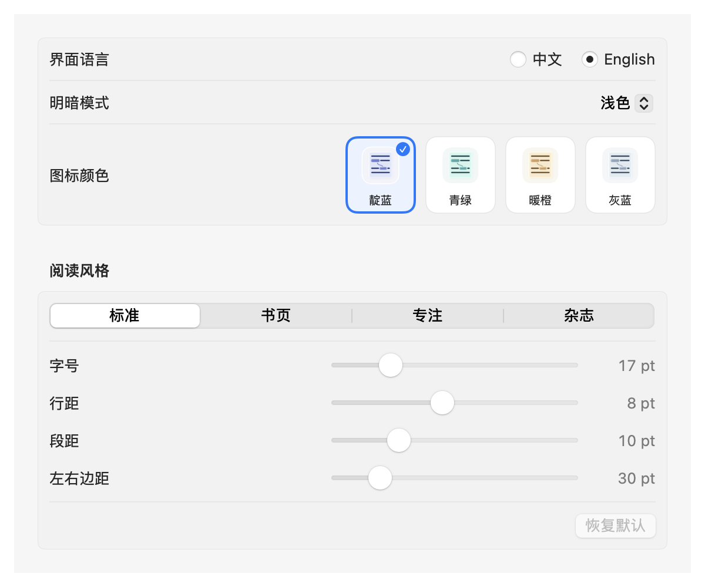

<div align="center">
  <h1>WordLinks（词文库）</h1>
  <p>
    <strong>原生 macOS 英语连续阅读与语境词语积累工具</strong><br />
    基于 SwiftUI 与 AppKit 打造，支持离线词形预填、双向短语精读与多引擎 AI 辅助
  </p>
  <p>
    <a href="README.md">English</a> · <a href="README.zh-CN.md"><strong>简体中文</strong></a>
  </p>
  <p>
    <a href="https://github.com/taoz66/WordLinks/releases/latest">
      
    </a>
    
    
  </p>
</div>

---

## 应用预览

<div align="center">
  
  <p><em>原生三栏连续阅读界面：内置 50 篇开放许可精选文章，支持一键切换专注阅读与双语精读模式。</em></p>
</div>

---

## 核心特性

### 1. 原生连续阅读与专注模式
- **原生体验**：基于 **SwiftUI + AppKit (`NSTextView`)** 开发，完整适配浅/深色模式与 macOS 26+ Liquid Glass 外观。
- **四种阅读风格**：内置 **标准、书页、专注、杂志** 四套主题样式，各样式独立记忆字号、行距、段距与左右边距。
- **专注阅读 (`⇧⌘F`)**：一键收起侧栏与文章列表，静止阅读时自动隐藏窗口控制栏，带来沉浸式阅读体验。
- **Markdown 与文件同步**：支持 Markdown 及 YAML 头解析、页内查找 (`⌘F` / `⌘G`)，支持绑定外部 `.md` / `.txt` 文件实时双向同步。

### 2. 语境划词建卡与词汇积累
- **划词积累**：阅读中选中单词或短语即可建卡，自动快照保存完整例句与原文位置。
- **离线词形还原预填**：基于内置只读英文词库，自动为常见屈折词预填词根原型（如 `books → book`、`arriving → arrive`），且绝不覆盖手动输入。
- **双视图复习与导出**：支持按「词条」聚合或按「文章」回看，点击「查看原文」精确回跳至原文位置；支持双击内联编辑与 `⌘Z` 撤销/重做，以及一键导出标准 6 列 CSV (`⌘E`) 与 JSON 完整档案备份。

### 3. 智能精读与多引擎 AI 接入
- **逐句精读与双向短语对齐**：开启精读后逐句呈现自然中文译文，鼠标悬停英文单词或中文短语时，自动双向高亮对应的语义词组。
- **内置 33 篇离线精读版本**：随包内置 2,149 句权威精读与 22,411 条严格校验的短语对齐数据，**无需配置 AI 或联网即可开箱秒开**。
- **灵活的三大 AI 服务接入**：
  - **ChatGPT**：官方开源 OAuth 授权登录直连。
  - **自定义 OpenAI 兼容 API**：支持各类远程模型端点及本地大模型（Ollama、LM Studio、vLLM 等）。
  - **Apple 智能**：macOS 26+ 支持系统端侧模型，零网络依赖。
- **划词即问 & AI 预填释义**：支持划词获取语境释义，并在建卡弹窗中提供 AI 候选释义（与手填文本严格分离）；所有 API 密钥与凭据均安全存储于 macOS 系统钥匙串（Keychain）。

<div align="center">
  <table>
    <tr>
      <td align="center" width="50%">
        
        <br /><sub><b>三大 AI 服务接入与智能预填开关</b></sub>
      </td>
      <td align="center" width="50%">
        
        <br /><sub><b>中英文界面、4 套主题图标与阅读排版定制</b></sub>
      </td>
    </tr>
  </table>
</div>

---

## 下载与安装

### 方式一：直接下载 DMG 安装包（推荐）
1. 前往 [**GitHub Releases**](https://github.com/taoz66/WordLinks/releases/latest) 下载最新的 **`WordLinks-v1.0.0.dmg`**。
2. 双击打开 `.dmg` 镜像，将 **Wordlinks.app** 拖入 **应用程序（Applications）** 文件夹即可。
3. 首次打开若 macOS 提示“无法验证开发者”，请右键点击 **Wordlinks.app** → 选择 **打开**（或在 **系统设置 → 隐私与安全性** 中点击“仍要打开”）。

### 方式二：从源码编译打包

**环境要求**：macOS 14.0+、Xcode 16+ / Swift 5.9+（推荐使用 Xcode 26+ 以完整启用 macOS 26 SDK `FoundationModels` 与原生分层图标编译）。

```sh
git clone https://github.com/taoz66/WordLinks.git
cd WordLinks

# 自动编译、安装图标并完成本地代码签名
zsh Scripts/build-app.sh
open build/Wordlinks.app
```

运行测试：
```sh
swift test
```

> 本地阅读档案、学习进度与最近 10 份自动备份保存于 `~/Library/Application Support/ReadingToolDaily/`。您也可以在该目录下的 `LocalCollections/*/catalog.json` 中放置私有本地文章集合，应用会自动加载。

---

## 内置开放许可阅读材料（50 篇）

应用内置 **50 篇** 经过排版清洗（去除学术角标、冗余图表与杂乱链接）的精选连续阅读材料，并完整保留原作者、日期、来源与许可说明：

| 合集 | 篇数 | 许可协议 | 涵盖主题 |
| --- | :---: | --- | --- |
| **Global Voices** | 5 | [CC BY 3.0](https://globalvoices.org/about/global-voices-attribution-policy/) | 全球人文故事、语言保护、地方文化 |
| **Wikipedia** | 30 | [CC BY-SA 4.0](https://creativecommons.org/licenses/by-sa/4.0/) | 生态保护、自然生物、考古发现、科学史 |
| **PLOS** | 15 | [CC BY 4.0](https://journals.plos.org/plosbiology/s/licenses-and-copyright) | 开放科学、生物多样性、科研与学习方法 |

---

## 详细文档

- [产品约定](docs/产品约定.md)
- [架构与维护](docs/架构与维护.md)
- [ChatGPT OAuth 集成说明](docs/chatgpt-integration.md)
- [文章导入模板（中文 / EN）](docs/article-templates/article-template.zh-Hans.md)

---

## 开源许可

WordLinks 的原创源代码、构建脚本与项目文档采用 [MIT License](LICENSE) 开源协议；随包内置的英文词形数据库与 50 篇开放许可文章各自保留其原始开源/CC 许可协议与声明。
